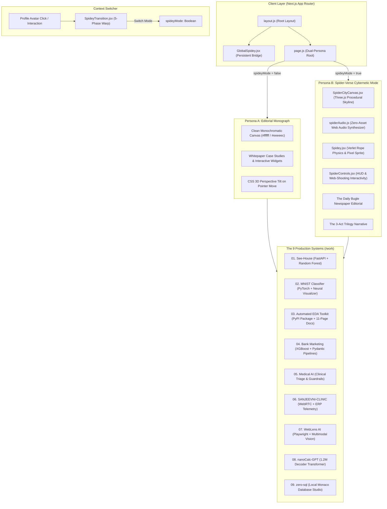
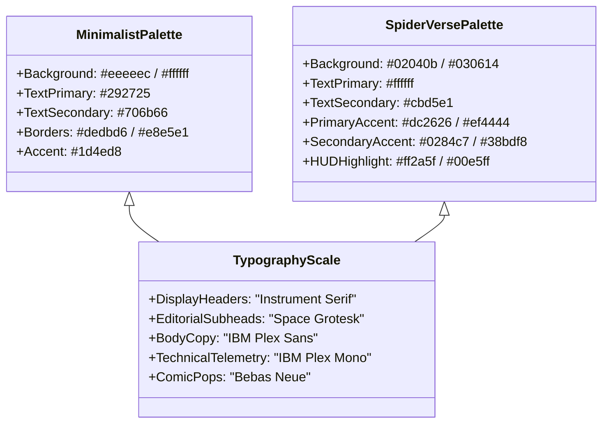

# Comprehensive Portfolio Analysis Report: Design to Contexts
**Subject**: Lochan Jangid — Machine Learning Engineer  
**Location**: Jaipur, Rajasthan, India  
**Platform**: Next.js 13+ (App Router), React 18, Three.js / React Three Fiber, Web Audio API, Tailwind CSS, Framer Motion  
**Date of Report**: November 2026  

---

## Executive Summary

Lochan Jangid's portfolio represents a masterclass in **thematic narrative engineering**, **dual-context interface architecture**, and **full-stack ML systems presentation**. Unlike conventional engineering portfolios that rely on static text descriptions or screenshots of Jupyter notebooks, this portfolio is built around a central, unifying ethos:

> *"Models are only the beginning. The real work is understanding the problem, preparing the data, making the system reliable, exposing it through an API, deploying it, and making sure someone can actually use it."*

The portfolio solves the classic developer dilemma—balancing corporate professionalism for technical recruiters with raw creative expression and gamified interactivity—by engineering a seamless **Dual-Persona Architecture**:
1. **The Editorial Monograph (Light Mode)**: An austere, high-typography Swiss/Editorial aesthetic designed for executive recruiters, engineering managers, and technical evaluators who prioritize clarity, methodology, and documentation.
2. **The Spider-Verse / Parker Archive (Dark Mode)**: An interactive, cinematic cybernetic experience activated via the profile avatar. It features an Earth-616 / Sector Jaipur HUD, a procedural 3D skyline, real-time Web Audio API sound synthesis, a 2,600+ LOC pixel physics engine (Pixel Spidey), and comic-book editorial easter eggs (*The Daily Bugle*).

---

## Architecture & System Overview



---

## 1. Design-to-Context Dual Persona Analysis

### Context A: The Editorial Monograph (Corporate / Recruiter Perspective)
* **Target Audience**: Engineering hiring managers, enterprise recruiters, staff engineers.
* **Contextual Goal**: Immediate credibility, zero friction, legible code snippets, mathematical rigor, and demonstrable business impact.
* **Visual Language**:
  * **Background & Canvas**: Soft natural paper tone (`#eeeeec`) for detailed case studies and clean `#ffffff` for root overview with `#292725` high-legibility carbon ink text.
  * **Typography**: Classic high-contrast editorial serif headers (`Instrument Serif`) paired with crisp industrial sans-serif (`IBM Plex Sans`) and monospaced accents (`IBM Plex Mono`).
  * **Interactive Subtlety**: The entire layout responds to mouse pointer telemetry with a gentle 3D perspective tilt (`perspective(1600px) rotateX/Y`) and dynamic specular highlights without distracting from readability.
  * **Project Presentation**: Compact, bulleted whitepaper summaries linked directly to live deployed endpoints, GitHub source trees, and structured case studies.

### Context B: The Parker Archive / Spider-Verse (Creative & Engineering Alter Ego)
* **Target Audience**: Fellow builders, game designers, 3D graphics enthusiasts, open-source contributors, visitors who value passion and craft.
* **Contextual Goal**: Emotional resonance, surprise, playfulness, demonstrating deep proficiency with WebGL (Three.js), Web Audio API, procedural algorithms, and game state mechanics.
* **Narrative Concept**: *"One person. Two lives. Too many tabs open. Building machine learning systems by day, debugging production problems by night."*
* **Visual Language**:
  * **Atmosphere**: Deep cosmic void (`#02040b` / `#030614`), CRT scanlines, halftone radial dots, and vibrant crimson accents (`#dc2626` / `#ff1744`) paired with electric blues (`#174ea6` / `#38bdf8`).
  * **HUD Telemetry**: Active status indicators (`SECTOR: EARTH-616 // JAIPUR HUB`, `COORD: 26.9124° N, 75.7873° E`, `CLEARANCE: LEVEL 5`).
  * **The Daily Bugle Easter Egg**: A authentic newsprint module (`#e9e5da`) with bold gothic typography declaring: *"LOCAL DEVELOPER ENTERS PRODUCTION: Machine learning engineer spotted moving models out of notebooks into APIs, containers, and deployed applications."*
  * **The Trilogy Philosophy**:
    * **Act I (Discovery)**: *Fundamentals. Understand before optimizing.*
    * **Act II (Dual Life)**: *Engineering. Theory into production software.*
    * **Act III (Dark Suit)**: *Control. Knowing where the power should stop.*

---

## 2. Interactive & Engineering Subsystems

### A. The Pixel Spidey Physics Engine (`Spidey.jsx`)
Spidey is not a simple pre-rendered GIF or video; it is a **2,616-line custom physics and animation engine** operating directly on the browser DOM:
* **Custom Pixel Matrix**: Characters are drawn at runtime via a 4px grid using coordinate matrices (`FRAMES.idle`, `walk1`, `walk2`, `jump`, `shoot`, `swing`, `hang`, `climb`) and precise color mapping.
* **Verlet Integration & Web Mechanics**: Dynamic physics simulation calculating gravitational acceleration (`GRAVITY = 1100`), velocity damping, rope tension, swinging arcs, and anchor point resolution.
* **Autonomous Behavior & DOM Snapping**: Spidey roams the browser window, clings to viewport borders, and uses ray-casting to identify target elements (like section headers or user click points).
* **Click-to-Shoot Interactivity**: Clicking on blank areas triggers a Web-shooter targeting vector, firing a web strand to the clicked point accompanied by comic onomatopoeia badges (*"THWIP!"*, *"SNAP!"*, *"FWIP!"*).

### B. Procedural 3D WebGL Cityscape (`SpiderCityCanvas.jsx` & `Spidey3D.jsx`)
* **Dynamic Generation**: Procedurally instantiates 3D skyscraper columns across depth planes ($Z = -14$ to $-8$) with stochastic heights and floor dimensions.
* **Procedural Window Textures**: Generates dynamic window lighting maps using an in-memory HTML5 Canvas texture generator rather than loading multi-megabyte image assets.
* **Parallax Telemetry**: Smooth spherical interpolation (`lerp`) binds mouse coordinates to the camera’s rotational matrix, creating realistic depth as the user inspects the page.
* **Rooftop Aviation Lights**: Emissive beacon cylinders equipped with localized Three.js `pointLight` sources.

### C. Zero-Dependency Synthetic Web Audio Engine (`spiderAudio.js`)
To guarantee zero network overhead, zero 404 errors, and sub-millisecond acoustic responsiveness, audio is synthesized mathematically in real-time via the browser's `AudioContext`:
* **The "THWIP!" Web Shot**: High-frequency sawtooth oscillator sweeping downward rapidly ($1400\text{ Hz} \to 180\text{ Hz}$ in 160ms) shaped through a resonant bandpass filter ($Q = 3.5$) with exponential gain decay.
* **Dimensional Glitch Hum**: Triangle oscillator ramping across low bass frequencies ($80\text{ Hz} \to 320\text{ Hz} \to 60\text{ Hz}$) with smooth volume enveloping.
* **HUD Blip & Comic Panel Click**: Pure sine burst ($880\text{ Hz} \to 440\text{ Hz}$ in 60ms).
* **Mission Unlock Chime**: Harmonized arpeggio across musical intervals $C_5 \to E_5 \to G_5 \to C_6$ ($523\text{ Hz}$ to $1046\text{ Hz}$).
* **Accessibility**: Fully respects `prefers-reduced-motion` and user mute toggles.

### D. The 5-Phase Dimensional Transition (`SpideyTransition.jsx`)
Activating Spider-Man mode calculates the exact bounding box of the user's avatar (`getBoundingClientRect()`) and executes a calibrated 5-phase dimensional warp:
1. `init`: Avatar scales and glows with crimson backlighting.
2. `web`: High-velocity web strands anchor to screen corners.
3. `tear`: Rotated polygon clip-paths split the screen diagonally (`polygon(...)`), mimicking comic-book panel shattering.
4. `reveal`: Dark cybernetic HUD fades in with chromatic aberration.
5. `complete`: Hands off control to the persistent canvas and clears transition nodes.

---

## 3. Deep-Dive: Design to Context across the 9 Missions

Each of the 9 featured systems solves a distinct computational or real-world problem and is presented with a specialized interface tailored to its domain context.

```
+----+---------------------+---------------------------+-----------------------------------------------+
| #  | System              | Domain Context            | Architectural Pipeline                        |
+----+---------------------+---------------------------+-----------------------------------------------+
| 01 | See-House           | Real Estate Regression    | Data -> Random Forest -> FastAPI -> UI        |
| 02 | Digit Recognition   | Deep Learning (MNIST)     | HTML5 Canvas -> PyTorch (Tanh) -> Tensor Feed |
| 03 | Automated EDA       | Open Source Data Science  | Profiler -> Imputation -> Pipeline -> PyPI    |
| 04 | Bank Marketing      | Financial Classification  | Pydantic Schemas -> XGBoost -> Cloud API      |
| 05 | Medical AI          | Clinical NLP & Triage     | Conversational UI -> LLM Guardrails -> Care   |
| 06 | SANJEEVNI-CLINIC    | Healthcare ERP & Video    | WebRTC -> LLM Scribe -> Queue Engine -> POS   |
| 07 | WebLens AI          | DevTools & Multimodal AI  | Playwright -> DOM Bounding Boxes -> LLM Code  |
| 08 | nanoCalc-GPT        | Transformer Mechanics     | 1.2M Decoder -> Target Reversal -> Arithmetic |
| 09 | zero-sql            | Database Systems          | Monaco Editor -> Local RAG -> Virtualized DOM |
+----+---------------------+---------------------------+-----------------------------------------------+
```

---

### Mission 01: See-House (California Housing Price Inference)
* **Context**: Predicting median block-group housing values from California census demographic and spatial features.
* **Design Implementation**:
  * **Interactive Model Interface**: An 8-feature parameter panel allowing users to adjust median income, house age, average rooms, bedrooms, population, occupancy, latitude, and longitude.
  * **Real-Time Client-to-API Bridge**: Form submission streams structured vectors to a live FastAPI cloud backend, returning valuation predictions with immediate error state handling.
  * **System Pipeline Visualization**: Step-by-step data transformation cards breaking down dataset profiling, outlier trimming, train/test splitting, and evaluation metrics ($R^2 = 0.795$, $\text{MAE} = \$34.2\text{k}$).

### Mission 02: Handwritten Digit Recognition (MNIST Classifier)
* **Context**: Low-latency computer vision classification of handwritten digits using PyTorch.
* **Design Implementation**:
  * **Live Drawing Canvas**: Interactive HTML5 drawing board capturing touch/mouse strokes, performing downscaling to $28 \times 28$ pixels, and applying grayscale normalization.
  * **Animated Neural Network Visualizer**: Visualizes the tensor flowing through the 5-layer architecture ($784 \to 286 \to 120 \to 10$ with hyperbolic tangent non-linearities).
  * **Real-Time Activation Wave**: Animated SVG nodes pulse based on trigonometric phase equations, illustrating how hidden layers activate before outputting the softmax probability distribution.

### Mission 03: Automated EDA Toolkit (`lochan-eda`)
* **Context**: Accelerating the repetitive, error-prone phase of Exploratory Data Analysis and data cleaning in machine learning pipelines. Published on PyPI.
* **Design Implementation**:
  * **Sub-Site Documentation System**: Contains a dedicated 11-page technical documentation portal (`/work/lochan-eda/docs/*`) complete with sidebar navigation, API references, and syntax-highlighted code blocks.
  * **Modular Architectural Diagram**: Highlights the interaction between `AutomatedEDA`, `Profiler`, `Numerical`, `Categorical`, `Missing`, and `Report` classes.
  * **Installation & Usage Banners**: One-click terminal copy widgets (`pip install lochan-eda`) and quick-start recipes for rapid onboarding.

### Mission 04: Bank Marketing (Deposit Subscription Predictor)
* **Context**: Optimizing direct banking telemarketing campaigns by predicting whether a client will subscribe to a term deposit.
* **Design Implementation**:
  * **Feature Engineering Deep-Dive**: Explains mathematical feature interactions (e.g., combining contact campaign intensity with previous interaction history: `campaign × previous`).
  * **Pydantic Validation Demonstration**: Documents strict schema enforcement validating banking variables before feeding transformed matrices to an XGBoost classifier.
  * **Production Deployment Status**: Direct link to the production web application hosted on Vercel Edge infrastructure.

### Mission 05: Medical AI (Conversational Clinical Triage)
* **Context**: Clinical symptom gathering and preliminary triage without making reckless or dangerous medical diagnostic claims.
* **Design Implementation**:
  * **Product Ethics & Non-Diagnostic Framing**: The interface explicitly visualizes safety boundaries—positioning the AI strictly as an intake assistant rather than an unlicensed diagnostic tool.
  * **Multi-Modal Session Handling**: Documents guest ephemeral access, authenticated persistent history, and an incognito mode for sensitive health queries.
  * **Care Discovery Flow**: Illustrates how symptom severity triggers localized facility recommendations (specialists, emergency clinics, hospitals).

### Mission 06: SANJEEVNI-CLINIC (Unified Clinical ERP & Telehealth)
* **Context**: Comprehensive hospital management combining doctor consultations, waiting queue logistics, telemedicine, and point-of-sale billing for Indian clinical practices.
* **Design Implementation**:
  * **Role-Based Tabbed Showcase**: Interactive tabs toggling views between Hospital Administrator (Executive ERP), Attending Physician (Clinician Cockpit), and Patients & Family (Patient Desk).
  * **Acoustic Queue System**: Browser-synthesized dual-oscillator acoustic chimes ($E_5 \to C_5$) announcing patient tokens on public TV lounge signage walls.
  * **Indian Digital Finance Context**: Native integration of dynamic Bharat QR and PhonePe UPI settlement verification.
  * **Encrypted WebRTC**: Peer-to-peer real-time video consults with live patient vitals telemetry.

### Mission 07: WebLens AI (Multimodal Visual Intelligence Studio)
* **Context**: Automated visual inspection and code generation for web interfaces using multi-model computer vision (Claude 3.7 / GPT-4o).
* **Design Implementation**:
  * **Playwright Telemetry Mapping**: Details how headless Chromium instances capture high-DPI screenshots while extracting exact DOM bounding box coordinates.
  * **WCAG 2.1 AA Contrast Engine**: Embedded luminance ratio mathematical formulas validating compliance for typography and buttons.
  * **Prompt Engine Matrix**: Compares prompt outputs across Claude 3.7 Sonnet (visual aesthetics & JSX refactoring), GPT-4o (conversion rate optimization), and Cursor/Windsurf (agent diff rules).

### Mission 08: nanoCalc-GPT (1.2M Parameter Decoder Transformer)
* **Context**: Training a compact autoregressive transformer from scratch to solve multi-digit arithmetic and overcome the right-to-left carry dependency bottleneck.
* **Design Implementation**:
  * **The Target Reversal Breakthrough**: Explains why standard autoregressive generation fails on addition (`11+06=17` requires predicting tens before units carry) and shows how reversing the target answer (`+7100`) enabled addition accuracy to surge from $\sim 50\%$ to $100.0\%$.
  * **Hyperparameter Specification Grid**: Clean technical table detailing $d_{\text{model}} = 128$, $n_{\text{layer}} = 6$, $n_{\text{head}} = 4$, context length = 12 tokens, AdamW with weight decay = 0.1, and OneCycleLR schedule.
  * **Interactive Calculator Widget**: Live arithmetic token sandbox demonstrating formatting rules.

### Mission 09: zero-sql (Local Privacy Desktop Database Client)
* **Context**: Modern alternative to bloated database tools, engineered with zero telemetry, complete offline privacy, and support for multi-engine relational and OLAP databases.
* **Design Implementation**:
  * **Multi-Engine Compatibility Grid**: Displays architecture support across SQLite, DuckDB, PostgreSQL, MySQL/MariaDB, and Microsoft SQL Server.
  * **Monaco Editor & Local RAG**: Details the integration of VS Code's editor engine with schema-aware autocompletion and safety guardrails (detecting unbounded `UPDATE`/`DELETE` queries without `WHERE` clauses).
  * **Virtualized Data Grid**: Highlights 60 FPS windowing algorithms that render tables with hundreds of thousands of rows without crashing browser memory.

---

## 4. Design System & UX Anatomy



### Color Semantics
* **Monograph Mode**: Built on neutral paper tones (`#f4f5f7`, `#ffffff`, `#292725`). Colors are used strictly for informational hierarchy: subdued gray for metadata labels, jet black for primary headings, and deep royal blue for interactive links.
* **Spider-Verse Mode**: High-contrast dark cybernetics. Jet-black voids provide infinite depth, while radiant crimson (`#ef4444`) commands high-priority attention. Electric blue (`#38bdf8`) signifies technical telemetry, and neon green (`#10b981`) indicates active production status.

### Typography Hierarchy
* **Instrument Serif**: Evokes traditional book design, academic journals, and high-end editorial essays. Lends gravitas and literary elegance to case studies.
* **Space Grotesk & Bebas Neue**: High-impact, condensed sans-serifs that power the Spider-Verse hero section and comic banners, delivering punchy, heroic impact.
* **IBM Plex Sans**: Engineered by IBM for readability on screens. Serves as the bedrock for all technical descriptions, lists, and form labels.
* **IBM Plex Mono**: Evokes developer terminals, compiler logs, coordinates, and pipeline diagrams.

---

## 5. Design-to-Context Synthesis Matrix

This matrix maps every notable visual or interactive design choice directly to its contextual rationale:

| Feature / Element | Design Choice | Contextual & Narrative Purpose |
| :--- | :--- | :--- |
| **Profile Picture Toggle** | Circular avatar with glowing crimson ring | Represents the "Secret Identity" trope: clicking the normal engineer reveals the costumed hero behind the screen. |
| **The Daily Bugle Newspaper** | Yellowed newsprint texture, serif headlines, column layout | Adds lighthearted self-awareness; frames production deployment as a front-page superhero event. |
| **Interactive Digit Canvas** | HTML5 drawing board + 784-input visualizer | Proves the PyTorch model works in practice; demystifies deep learning for non-technical visitors. |
| **Target Reversal Diagram** | Token sequence flow in nanoCalc-GPT | Explains a complex autoregressive transformer bottleneck simply and intuitively. |
| **Synthetic Audio (Web Audio API)** | Zero-asset oscillators for "THWIP!" sounds | Provides tactile feedback without compromising site performance or causing network latency. |
| **Pixel Spidey Companion** | Autonomous roaming physics sprite | Showcases game-loop engineering, Verlet rope physics, and dom-interaction algorithms without external engines. |
| **FastAPI Form Sliders** | Real estate input sliders for See-House | Transforms an abstract regression equation into an intuitive, tactile simulation tool. |
| **Monaco Editor Embedding** | VS Code SQL engine in zero-sql | Communicates desktop-grade developer tool ergonomics and local privacy capabilities. |
| **TV Signage & Web Audio Chimes** | Hospital queue acoustic bells in Sanjeevni | Reflects the real-world operational chaos of Indian clinics and shows how software solves it. |

---

## 6. Strategic Recommendations & Opportunities

1. **Automated Live Health Check Indicators**:
   * *Opportunity*: For deployed projects (`See-House`, `Bank Marketing`, `Medical AI`), integrate lightweight automated status badges (e.g., green ping dot showing live API response times).
   * *Impact*: Reinforces the portfolio's emphasis on reliable, running production infrastructure.
2. **Interactive Playground Toggle on Case Studies**:
   * *Opportunity*: Allow visitors on `/work/*` case study pages to toggle an inline "Spidey Note" or developer commentary side-drawer.
   * *Impact*: Bridges the gap between the whitepaper view and the creative superhero narrative across subpages.
3. **Open-Graph & Social Share Dynamic Preview**:
   * *Opportunity*: Configure dynamic `@vercel/og` image generation displaying project metrics directly on Twitter/LinkedIn link cards.
   * *Impact*: Boosts click-through rates from social shares and technical recruitment platforms.
4. **Performance & WebGL Fallback Polishing**:
   * *Opportunity*: Ensure low-power mobile devices gracefully drop from the procedural 3D skyline to the pre-rendered halftone canvas.
   * *Impact*: Guarantees smooth 60 FPS performance across all hardware tiers.

---

## Conclusion

Lochan Jangid's portfolio is a remarkable synthesis of **engineering rigor** and **creative storytelling**. By giving equal weight to rigorous machine learning case studies (with real mathematical metrics, clean APIs, and open-source packages) and immersive interactive front-end engineering (Three.js WebGL, Web Audio synthesis, Verlet physics), the portfolio proves that the engineer behind it does not just write algorithms in isolation—he crafts end-to-end digital experiences that are robust, useful, and unforgettable.
